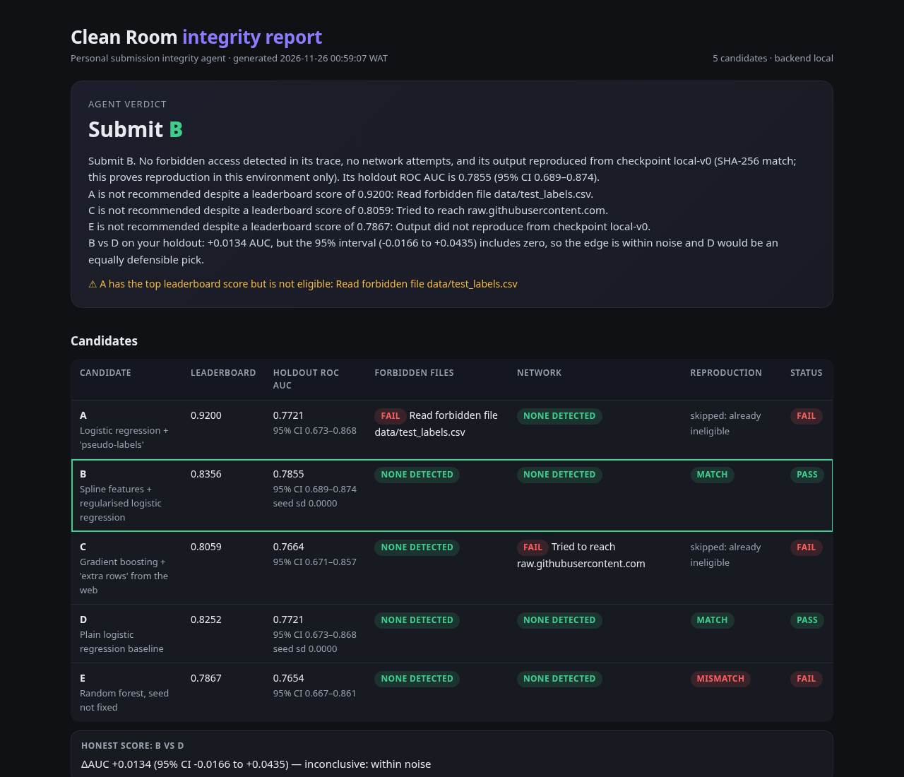

# Clean Room

**A personal submission integrity agent for ML competitions, running on Fly.io Sprites.**

You have five candidate submissions for a Kaggle- or Zindi-style competition. One of them has the
best leaderboard score. Is it safe to send? Clean Room answers that *before* you submit:

1. **Rules → policy.** Paste the competition rules. Clean Room extracts which files you may and
   may not read, whether internet access is allowed, which hosts are allowed, whether external
   data is allowed and whether results must be reproducible. Every rule keeps the clause number
   and the exact quote it came from.
2. **Isolated, traced runs.** Each candidate runs from the same checkpoint with egress denied,
   while Clean Room records every file it opened and every host it tried to reach
   (`strace -f` plus a Python audit hook).
3. **Findings with evidence.** Each finding quotes the rule it relies on and shows the exact
   trace lines behind it.
4. **The agent investigates.** A forbidden file was read? It re-runs from the checkpoint with that
   file hidden and reports whether the score depended on it. A network call? It checks whether the
   output still appears with egress denied.
5. **Reproduction.** It restores the checkpoint, re-runs, and compares the output's SHA-256.
6. **Honest score (optional).** Bootstrap 95% interval on *your own* holdout, a paired bootstrap
   for "is B really better than D?", and the spread across three seeds.
7. **Recommendation.** It recommends the best *eligible* candidate by holdout score, never by the
   public leaderboard, and explains why the others were rejected. The report is a single HTML page
   served on port 8080 (the Sprite's public URL port).

```
$ cleanroom agent
[1/7] Rules → policy: 6 rules from rules.txt
[4/7] Running candidates from the checkpoint
  A: exit 0, sha256 bab13241deae…, FAIL
    leaderboard 0.9200 · holdout AUC 0.7721
    FAIL Read forbidden file data/test_labels.csv
      rule 1.2: “The file test_labels.csv is provided for organiser scoring only and must not be read by participant code.”
      ↳ strace.135253:1830  openat(AT_FDCWD, "data/test_labels.csv", O_RDONLY|O_CLOEXEC) = 4
[5/7] Investigating red flags
  A: Without data/test_labels.csv the output changes and the leaderboard score moves from 0.9200 to 0.8252:
     the score depends on the forbidden file.
[6/7] Verifying reproduction from the checkpoint
  B: MATCH · SHA-256 212e37d39ed6e5f4… matched on re-run. This proves reproduction in this environment only.
  E: MISMATCH · Fix random seeds and remove other non-determinism before submitting.
Recommendation: B
```



## Why Sprites

Clean Room needs three things a plain container makes awkward, and Sprites provide natively:

| Need | Sprite feature |
| --- | --- |
| Run untrusted competition code with no internet | **Network policy**, set from *outside* the Sprite through the Sprites API, read-only inside at `/.sprite/policy/network.json`. The code under test cannot loosen it. |
| Start every candidate from the identical machine, and re-run later to prove reproduction | **Checkpoints** (`POST /v1/sprites/{name}/checkpoint`, restore by id). Copy-on-write, so one per candidate is cheap. |
| Keep secrets away from the code under test | The worker never receives any credential. The agent drives it over the Sprites API with a token kept in a private 0600 file on the agent Sprite. The **Sprites GitHub connector** keeps the GitHub credential off both Sprites: the agent posts the verdict ledger through the Sprites gateway, and the connector's policy admits only `cleanroom-agent*` and only the ledger repo's paths. |
| A report you can open from anywhere | Every Sprite has an HTTPS URL routed to port 8080. |

### Two Sprites

```
 you ──► cleanroom-agent (public URL :8080)              cleanroom-worker (private)
          • agent loop, rules → policy                    • runs candidate code
          • SQLite ledger, traces, report      Sprites    • egress: deny * (policy set from outside)
          • GitHub ledger via connector     ──Sprites───► • strace + audit hook
          • Sprites token: 0600 file          API         • checkpoint per run, restore = wipe
                                                          • never sees any token
```

Restoring a checkpoint wipes the worker's whole disk. That is the point (every run starts identical),
and it is why the ledger, traces and report live on the agent Sprite, never on the worker.

## Honest limits

- **"No forbidden access detected" is not "safe".** It means no forbidden open appeared in the traced
  syscalls and Python audit events. Tracing cannot see leakage that is already inside the training
  data, labels typed into code by hand, or side channels. A program that deliberately evades an
  in-process audit hook (for example via `ctypes`) is still visible to strace, but not the reverse.
- **A hash match proves reproduction in that environment only**, from that checkpoint, with those
  library versions and that hardware. Seeds must be fixed (Clean Room sets `PYTHONHASHSEED=0`; your
  code must seed its own RNGs).
- **Egress enforcement differs by backend.** Locally: an empty network namespace (`unshare -rn`), all
  or nothing. On a Sprite: the DNS-based network policy, which also blocks raw IPs not resolved from
  an allowed domain.
- **The honest score is about your holdout**, not the private leaderboard. It shows whether a gain is
  larger than the noise in your own data.
- **Rules-to-policy is heuristic.** The deterministic extractor needs no API key. An optional LLM pass
  (any OpenAI-compatible endpoint) can add rules, but a rule is kept only when its quote appears
  verbatim in the rules text. Always read the policy table.
- Tracing a process (`ptrace`) needs permission. It works on most Linux machines for your own child
  processes; when it does not, Clean Room falls back to the audit hook and says so in the report.

## Run it locally

Requirements: Linux, Python 3.10+, `strace` (optional but recommended), `unshare` (util-linux).

```bash
pip install -e '.[dev]'           # numpy + scikit-learn for the demo, pytest for the tests
sudo apt-get install -y strace    # optional
cd demo
python3 make_data.py              # builds the demo competition from sklearn's built-in diabetes data
cleanroom doctor                  # what isolation + tracing works on this machine
cleanroom agent --serve           # full loop, then serves the report on http://localhost:8080
```

Individual commands:

```bash
cleanroom policy rules.txt                         # rules → policy (add --json for machine output)
cleanroom run --name B -- python3 candidates/b_spline_logreg.py
cleanroom verify B                                 # restore checkpoint, re-run, compare SHA-256
cleanroom investigate A                            # follow up A's red flags
cleanroom report --serve --port 8080
```

Your own competition: put your code, data and `rules.txt` in a folder and add a `cleanroom.json`
(see `demo/cleanroom.json`): output file name, optional holdout predictions + truth for the honest
score, optional leaderboard command, your own extra files (`own_files`) and the candidate commands.
Never upload private competition data anywhere; the Sprite backend copies your project only to your
own worker Sprite.

### The demo competition

Built from scikit-learn's built-in diabetes dataset (Efron et al., 2004; no download). Target: is
disease progression after one year above the median? The bundle "accidentally" ships
`test_labels.csv`, and `host/leaderboard.py` plays the organiser, scoring even ids as the public split.

| Candidate | What it does | Clean Room verdict |
| --- | --- | --- |
| A | logistic regression + "pseudo-labels" that read `test_labels.csv` | FAIL: forbidden file; score depends on it |
| B | spline features + regularised logistic regression, seeded | PASS, reproduced: **recommended** |
| C | gradient boosting that first tries to download "extra rows" | FAIL: network attempt (blocked) |
| D | plain logistic regression | PASS, reproduced |
| E | random forest with no seed | FAIL: output did not reproduce |

## Deploy on Sprites (two-Sprite setup)

You need a Fly.io account with Sprites enabled and a **Sprites API token**
(`sprite login`, or create one at https://sprites.dev/account; format
`org-slug/org-id/token-id/token-value`). A general Fly.io org token (`FlyV1 fm2_…`) is not accepted by
the Sprites API.

```bash
curl -fsSL https://sprites.dev/install.sh | sh     # sprite CLI (optional, handy for inspection)
export SPRITES_TOKEN=...                           # never commit or print it
python3 demo/make_data.py
python3 deploy/deploy_sprites.py
```

`deploy/deploy_sprites.py` does, through the documented Sprites REST API:

1. creates `cleanroom-worker` (private URL) and `cleanroom-agent` (public URL);
2. sets the worker's network policy to `{"rules":[{"domain":"*","action":"deny"}]}`;
3. writes your Sprites token to `/home/sprite/.config/cleanroom/sprites_token` on the **agent** Sprite,
   mode 0600, as the body of an fs-write request (never in a URL, command line, log or the report).
   The agent reads it through `SPRITES_TOKEN_FILE`;
4. uploads Clean Room + the demo to the agent and installs it;
5. registers a Sprite **service** on port 8080 serving the live report;
6. starts `cleanroom --backend sprite agent` detached on the agent Sprite and follows its log
   (a long single HTTP exec gets dropped by the proxy, so the loop runs under `setsid`).

**Why not a connector for the Sprites token?** The first version wrapped the Sprites API in a
Custom API connector so the agent would never hold the token. The Sprites gateway refuses that
(`403 blocked: base URL targets the Sprites API itself`), so the token lives in a private file on the
agent Sprite instead. The worker, which runs the untrusted code, never receives it: Clean Room passes
candidates only the variables it sets itself.

During `prepare`, the agent briefly opens the worker's egress to the platform defaults
(`{"include":"defaults"}`) to install `strace` and the demo's Python packages, then sets the
deny policy derived from the rules and verifies it from inside (`/.sprite/policy/network.json` and a DNS
probe that must be refused) *before* any candidate runs.

Manual equivalent with the CLI:

```bash
sprite create cleanroom-worker && sprite create cleanroom-agent
curl -X POST https://api.sprites.dev/v1/sprites/cleanroom-worker/policy/network \
  -H "Authorization: Bearer $SPRITES_TOKEN" -H 'Content-Type: application/json' \
  -d '{"rules":[{"domain":"*","action":"deny"}]}'
sprite -s cleanroom-agent exec -- bash -c 'cd ~/cleanroom/demo && cleanroom --backend sprite agent'
```

### The Sprites connector: GitHub ledger

Clean Room's Sprites connector is **GitHub** (OAuth). Every session, the agent Sprite opens one issue
per candidate in a private ledger repo: verdict, checkpoint, output SHA-256, reproduction result, the
rule clauses quoted word for word and the trace lines behind each finding. The report links each
candidate to its issue, so a decision you made before a deadline stays on record outside the Sprites.

The Sprite never holds a GitHub token. It calls
`https://api.sprites.dev/v1/gateway/github/<connection_id>/repos/<owner>/<repo>/issues` with no
`Authorization` header; the gateway identifies the calling Sprite, checks the connector's access policy
and attaches the stored credential.

Setup:

1. In the Sprites dashboard, add a **GitHub** connector and approve the OAuth screen.
2. Create a private repo for the ledger (for example `you/cleanroom-ledger`).
3. Deploy with the ledger turned on:

   ```bash
   python3 deploy/deploy_sprites.py --publish --github-repo you/cleanroom-ledger
   ```

   The script finds the GitHub connector through `GET /v1/oauth/connections` and pins its access
   policy to `{"name_prefix": "cleanroom-agent", "allowed_endpoints": ["/repos/you/cleanroom-ledger",
   "/repos/you/cleanroom-ledger/*"]}`. Only the agent Sprite can use the connector, and only for that
   repo. The worker, which runs untrusted code, is not admitted, and its egress is denied anyway. The
   script then checks from inside the agent Sprite that the ledger repo answers 200 and that a path
   outside the allow-list (`/user`) is refused. Finally it passes `CLEANROOM_GITHUB_GATEWAY` and
   `CLEANROOM_GITHUB_REPO` to the agent and runs `cleanroom agent --publish`.

Without `--publish`, the issue payloads are written to `.cleanroom/outbox/` for review and nothing is
posted. Optionally, an LLM connector (OpenRouter, or Ollama Cloud through a custom API connector) can
write the plain-language verdict and run an extra rules pass, via `CLEANROOM_LLM_BASE_URL` /
`CLEANROOM_LLM_MODEL`. The live run below did not use one.

### Sprite deployment status (live run, 26 Nov 2026)

The full 7-step loop has run on real Sprites (`cleanroom-agent` driving `cleanroom-worker`); the
log is in `docs/sample_sprite_run.txt`. Checked live:

- **Egress denied:** with the `deny *` policy, inside the worker DNS is refused, HTTPS to
  example.com fails and a raw-IP connect to 1.1.1.1:443 fails. Candidate C's DNS queries for
  `raw.githubusercontent.com` show up in strace and go unanswered.
- **strace works inside a Sprite**, tracing its own children (`tracer: strace+audit` for every run).
- **Exec reply format:** the non-TTY HTTP exec returns frames: `0x01`+stdout, `0x02`+stderr,
  then `0x03`+one exit-code byte. That is parsed by `parse_exec_stream`. Results still come back through
  the filesystem API.
- **Checkpoint / restore:** restoring wipes files written after the checkpoint, and every candidate
  ran from the same checkpoint.
- **Network policy survives a restore:** the API still reports `deny *` after a restore, and the DNS
  probe taken during every restored run says `refused`.
- **GitHub connector:** with `--publish`, all five verdicts were posted through the Sprites GitHub
  connector as issues #1–#5 in the private ledger repo (labels `cleanroom`, `pass`/`fail`,
  `recommended` on B), and the live report links each candidate to its issue. From inside the agent
  Sprite, the gateway answered 200 for the ledger repo and 403 for `/user`, which is outside the
  allow-list.

Known quirks:
- `/.sprite/policy/network.json` was not present inside the worker even though the policy was
  enforced, so Clean Room checks enforcement by probing rather than by reading that file.
- One long HTTP exec gets dropped after a few minutes, so the deploy script starts the loop detached
  and follows its log.

## Layout

```
cleanroom/            the package
  policy.py           rules → policy (deterministic) + optional LLM merge
  trace.py            strace (-ff -xx) and audit-hook parsing, DNS query decoding
  checks.py           findings: forbidden files, network, run status, reproduction
  backends/           Backend interface; LocalBackend; SpriteBackend (Sprites API client)
  engine.py           run / verify / investigate / seeds, recorded in the SQLite ledger
  agent.py            the 7-step agent loop
  summary.py, recommend.py, scoring.py, report.py, ghledger.py, llm.py, cli.py
  _hook/sitecustomize.py   the Python audit hook injected into candidate runs
demo/                 mock competition: rules.txt, cleanroom.json, candidates A–E, host leaderboard
deploy/               two-Sprite deploy script
tests/                pytest suite
```

## Licence

MIT.
